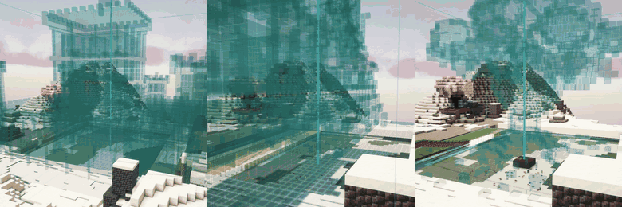
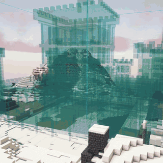
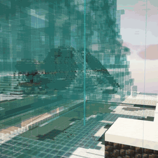
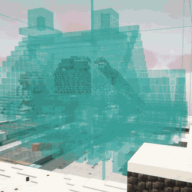
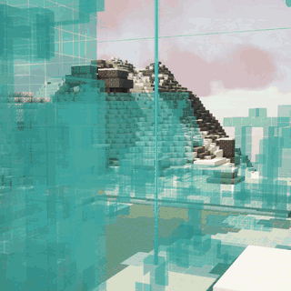
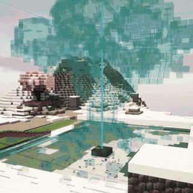
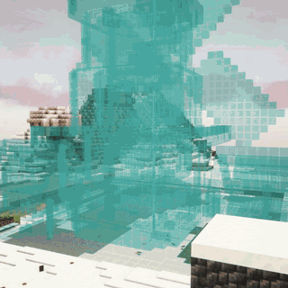
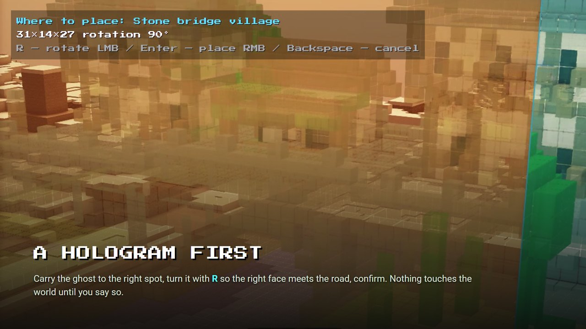
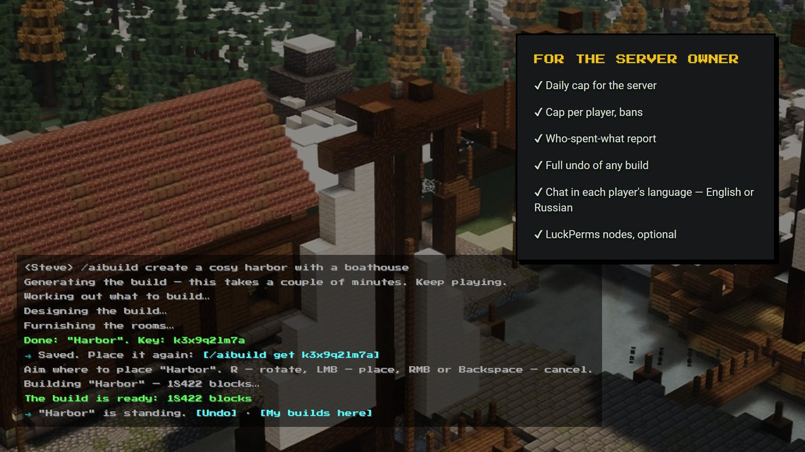

<h1 align="center">Farmstead AI Builder</h1>

<p align="center">
  <a href="README.md">Русский</a> · <b>English</b>
</p>

<p align="center">
  <b>A Minecraft mod that builds from a text prompt.</b><br>
  A player types <code>/aibuild create a medieval tavern with a porch</code> — a couple of minutes
  later the building rises in front of them, block by block.
</p>

<p align="center">
  
  
  
  
</p>

<p align="center">
  
</p>

<p align="center">
  <a href="https://github.com/shtanko-michael/farmstead-aibuilder/releases/latest/download/farmstead-aibuilder-neoforge-1.21.1.jar"><b>⬇ Download the latest version</b></a>
  ·
  <a href="https://farmsteadminecraft.online/cabinet/ai-builder"><b>Get a token</b></a>
  ·
  <a href="#commands">Commands</a>
  ·
  <a href="#permissions-and-luckperms">Permissions</a>
</p>

---

## See it

| | |
|---|---|
|  |  |
| A castle rises out of its hologram | A galleon in its own dock |
|  |  |
| A timber tavern, course by course | A whole harbour from one prompt |
|  |  |
| Not only buildings: a sakura garden | A windmill, sails and all |
|  |  |
| The hologram: where and which way, R to rotate | Every step told in chat, commands clickable |

Filmed on a real server with shaders, sped up 4×.

---

## What the mod does

**Text-to-build generation.** A player describes what they want in plain words — a house, a tower, a
bridge, a farm, a whole plaza — and gets a finished structure. These are not pre-made schematics:
every build is planned for the prompt it was given, so "a small fisherman's hut on stilts" and "a
tall stone tower with a flag" come out as different buildings rather than one template retextured.

**A hologram before anything is placed.** Not a single block is written to the world until the player
agrees. The structure first appears as a ghost under the crosshair: carry it further out, turn it
with `R` so the right face meets the road, and only then confirm. Cancelling is one click and
nothing happened.

**Built in front of you, not "poof, there it is".** Blocks are laid in courses from the ground up,
glowing dust trails the laying front, each block that lands flashes, and a beam comes down from the
sky. This is not decoration for its own sake: the player sees exactly what goes where and still has
time to change their mind. The server does not stall for it — placement runs on a budget of a couple
of milliseconds per tick rather than in one lump.

**Generate into a selected region.** `/aibuild area` marks corners in the world, and the build is
generated **for that volume**: not cropped to it, but planned to fit it. Useful for slotting a
building into an existing street.

**Full undo.** The mod remembers what stood under every build, and `/aibuild undo` puts the ground
back the way it was — trees, slope and the road somebody had run through it. You can undo not just
the last build but any row of `/aibuild placed`.

**A library per player.** Builds are saved: `/aibuild list` shows your own, `/aibuild get <key>`
places one again — somewhere else, facing another way, as many times as you like, and for free.

**Works with a vanilla client.** A player without the mod can still use the command — the build is
simply placed in front of them, with no aiming. But the hologram and the animation are drawn by the
client half, so the mod is worth handing out to everyone.

**Spend control for the administrator.** Generation is paid for with tokens from your account, and
you decide who may spend how much: a daily cap for the whole server, a cap per player, a personal
cap for one person, bans for individuals. All of it on one page in the cabinet, together with a
"who spent what" report.

---

## How it works

1. **A player runs the command.** `/aibuild create <description>` — ordinary text, in English or
   Russian.
2. **Generation runs on our service.** Your server sends the description to
   `ai.farmsteadminecraft.online` and receives a finished set of blocks. Models, prompts and compute
   are on our side; your server needs neither a GPU nor any AI provider keys.
3. **The mod places the build.** Hologram, confirmation, layer-by-layer placement, and a record that
   makes it undoable.

The **token owner pays** — you, from your AI-token balance on
[farmsteadminecraft.online](https://farmsteadminecraft.online). A build usually costs **200–600
tokens**; caps and spend are visible in the cabinet.

---

## Supported builds

| Loader | Game version | Release file |
|---|---|---|
| NeoForge | 1.21.1 | `farmstead-aibuilder-neoforge-1.21.1.jar` |

Paper/Purpur, Fabric and Forge 1.20.1 are planned.

The file name carries no version on purpose: an update **overwrites** the old jar instead of leaving
a second one with the same mod id beside it (FML resolves that by silently loading one of them). The
version lives in the release title and in the jar manifest. A permanent link to the current build:
[releases/latest/download/farmstead-aibuilder-neoforge-1.21.1.jar](https://github.com/shtanko-michael/farmstead-aibuilder/releases/latest/download/farmstead-aibuilder-neoforge-1.21.1.jar).

## Requirements

- A **NeoForge 1.21.1** server, Java 21.
- **The same jar on players' clients**, in their `mods/`: the client half draws the aiming hologram
  (`R` rotates, LMB/Enter places, RMB/Backspace cancels) and the whole build animation.
- An account on [farmsteadminecraft.online](https://farmsteadminecraft.online) with AI tokens on the
  balance.
- Outbound HTTPS from the server to `ai.farmsteadminecraft.online`.
- **LuckPerms is optional.** You only need it to hand commands out per group rather than by the
  permission levels in the config.

A player **without** the mod can join (nobody rejects them), but the build just appears in front of
them — no aiming, no animation. That is a fallback, not a way to play.

## Installation

1. Download the [latest release](https://github.com/shtanko-michael/farmstead-aibuilder/releases/latest)
   and drop the jar into the server's `mods/`. Hand the same file to your players.
2. Start the server once — `config/farmstead_aibuilder.toml` appears.
3. In the cabinet at [farmsteadminecraft.online/cabinet/ai-builder](https://farmsteadminecraft.online/cabinet/ai-builder)
   press "Create token". The value is shown **once** — copy it straight away.
4. Put it into the config:

   ```toml
   [api]
   api_base_url = "https://ai.farmsteadminecraft.online"
   bearer_token = "fsm_..."
   ```

5. Restart the server. Two lines appear in the log:

   ```
   [Farmstead] AI service OK: server='Main server' mode=external apiVersion=1 …
   [regionguard] API not available (…) — claim checks are skipped
   ```

   The first means the token was accepted. If you see
   `[Farmstead] the AI service rejected this server's token` instead, the token is wrong or revoked. The
   second is about land protection, see [below](#land-protection).

The token is a key to your wallet. Do not publish the config. If it leaks, revoke it in the cabinet
and create a new one.

## Commands

Only `create` (and `area build`) spends tokens. Everything else is free.

| Command | What it does | Tokens | Node |
|---|---|---|---|
| `/aibuild create <description>` | Generate a build and place it through the hologram | **yes** | `aibuilder.command.create` |
| `/aibuild area` | Selection mode: LMB sets corner 1, RMB corner 2, Backspace exits | — | `aibuilder.command.area` |
| `/aibuild area build <description>` | Generate **into the selected region** | **yes** | `aibuilder.command.area` |
| `/aibuild area pos1` / `pos2` / `clear` | Corners from the player's position (for clients without the mod) and reset | — | `aibuilder.command.area` |
| `/aibuild list [page]` | Your own builds as a list; a row is clickable | — | `aibuilder.command.list` |
| `/aibuild get <key>` | Place one of your builds again | — | `aibuilder.command.get` |
| `/aibuild placed [page]` | Which of your builds stand in this world | — | `aibuilder.command.placed` |
| `/aibuild undo` | Take the last build down and restore what was under it | — | `aibuilder.command.undo` |
| `/aibuild remove <n>` | The same for any row of `placed` | — | `aibuilder.command.undo` |
| `/aibuild balance` | How many tokens the player has left today | — | `aibuilder.command.balance` |
| `/aibuild topup` | Explains that the administrator pays for generations | — | `aibuilder.command.topup` |
| `/aibuild`, `/aibuild help` | The commands this player may use | — | — |
| `/aibuild about` | Mod version and the server's registration | — | — |
| `/aibuild status` | Today's spend, the effective cap, cooldown and wallet state (operators, works from the console) | — | `aibuilder.command.status` |

Builds made by players on your server are visible only there: they have no access to the Farmstead
launcher or marketplace, and your own cabinet does not show them either — only the spend.

## Permissions and LuckPerms

Every subcommand has **two doors, and either one is enough**:

1. **A vanilla permission level** from `config/farmstead_aibuilder.toml`, section `[permissions]`:
   `0` — everyone, `2` — operators (the `/give`, `/setblock` tier), `4` — owner/console.
2. **A node** `aibuilder.command.*`, granted by a permission manager.

All levels default to `0`, so the commands are open to everyone: the real limiter is your daily caps
in the cabinet, not permissions.

> **Order matters.** A node changes nothing while `level = 0`: everyone clears level 0 and the node
> is never consulted. Raise the level first, then grant the node.

The mod declares its nodes to the NeoForge Permission API, so **LuckPerms sees them on its own** —
nothing else to install.

A typical "generation for donors only, the rest for everyone" setup:

```toml
# config/farmstead_aibuilder.toml
[permissions]
create_level = 4   # closed create and area to everyone but the console
area_level   = 4
```

```
/lp creategroup builder
/lp group builder permission set aibuilder.command.create true
/lp group builder permission set aibuilder.command.area true
/lp user Steve parent add builder
```

For one player without a group: `/lp user Steve permission set aibuilder.command.create true`.
To take it back: `/lp group builder permission unset aibuilder.command.create` — then the level
decides again.

The full list of nodes:

```
aibuilder.command.create    aibuilder.command.area     aibuilder.command.get
aibuilder.command.list      aibuilder.command.placed   aibuilder.command.undo
aibuilder.command.balance   aibuilder.command.topup    aibuilder.command.status
```

`undo` and `remove` share one node (`aibuilder.command.undo`): it is one power over the same records.

**Without a permission manager** no node is ever granted and the config levels are the whole gate.
Operators pass everything: `/op` grants level 4, which clears any level below it.

## Limits and spend

All of it in the cabinet, on the same page where the token was created:

- **Daily limit for the server** — how many tokens the server may spend per day (UTC).
- **Daily limit per player** — the default for everyone; in the player table you can set a personal
  one or **ban** a player from generating.
- **Report** — who spent what over 7 / 30 days, per player and per day.

Limits are enforced on the service side, not in the mod: they take effect immediately, no restart is
needed, and updating the mod does not reset them.

## Land protection

The mod can ask **RegionGuard** and **Farmstead Claims** (Farmstead Claims wins when both are installed). What it does is visible in the log at startup:

| Log line | What it means |
|---|---|
| `[regionguard] API available (ClaimsApi / RegionGuardApi) — claims are enforced for non-operators` | Claims are checked: the whole build must fit inside the player's region |
| `[regionguard] API not available — claim checks are skipped` | The plugin is absent, the mod knows nothing about your claims and checks **no land** |

Without a claims mod a player will place a build anywhere the command is allowed. Options: raise
`create_level`/`area_level` and grant the node to people you trust, cap the daily limit — or install
RegionGuard or Farmstead Claims.

If a claims mod is installed but its call fails, the mod **refuses** the placement and logs
`[regionguard] claim check failed` — a protection check that errors must not read as "permitted".

## What is sent to the service

With every request the service receives: the **build description**, the **player id** (UUID) and
**their nickname** — so that the spend report can show you who spent what. Nothing else is read from
your server. The snapshot of "what stood under the build" is stored as opaque bytes and exists only
for `/aibuild undo`.

## Troubleshooting

| In the log or in chat | What it means |
|---|---|
| `[Farmstead] … rejected this server's token` | The token is wrong or revoked — check `bearer_token` |
| `Your limit for today is used up` | The player's daily cap — raise it in the cabinet or wait for midnight UTC |
| `The server's daily limit is used up` | The server's daily cap — same |
| `The server administrator has turned off build generation for you` | The player is on the deny list |
| `The service is busy` | Too many generations at once — try again in a minute |
| `Not enough AI tokens` | Your AI wallet is below the minimum — top it up in the cabinet |
| `[regionguard] claim check failed` | A claims mod is installed but its call failed; placements are refused until that is fixed |
| A command with non-Latin text "does not go through" | Some mod filters characters in commands (in NeoEssentials it is `security.allowUnsafeCommands`) |

## Language

The mod speaks English and Russian. By default every player reads chat in their own game language (Russian for Russian, Ukrainian, Belarusian and Kazakh clients, English for everyone else); the hologram hints on screen always follow the client. To pin one language for the whole server:

```toml
# config/farmstead_aibuilder.toml
[language]
language = "en_us"   # auto | en_us | ru_ru
```

Bugs and suggestions: [Issues](https://github.com/shtanko-michael/farmstead-aibuilder/issues).

## License

Installing it on your own servers and **handing it to the players of your server** is allowed,
including on paid servers. Publishing it on file-sharing sites and mod catalogues, decompiling and
modifying it is not. Full text: [LICENSE.md](LICENSE.md).

Version history: [CHANGELOG.md](CHANGELOG.md). If you found a way around the token, the limits or the
permissions, see [SECURITY.md](SECURITY.md) — do not open a public issue.
