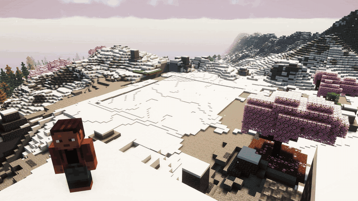
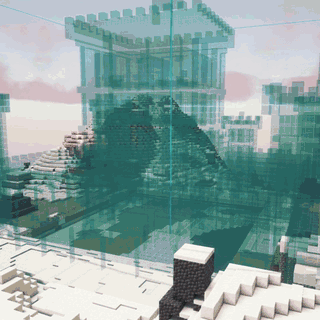
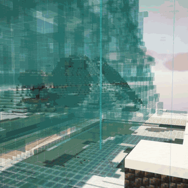
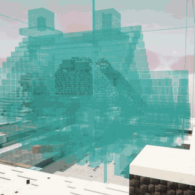
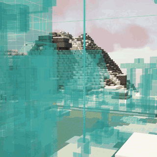
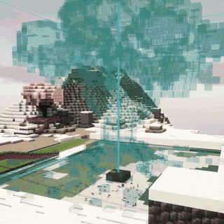
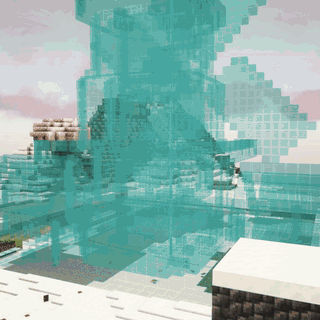
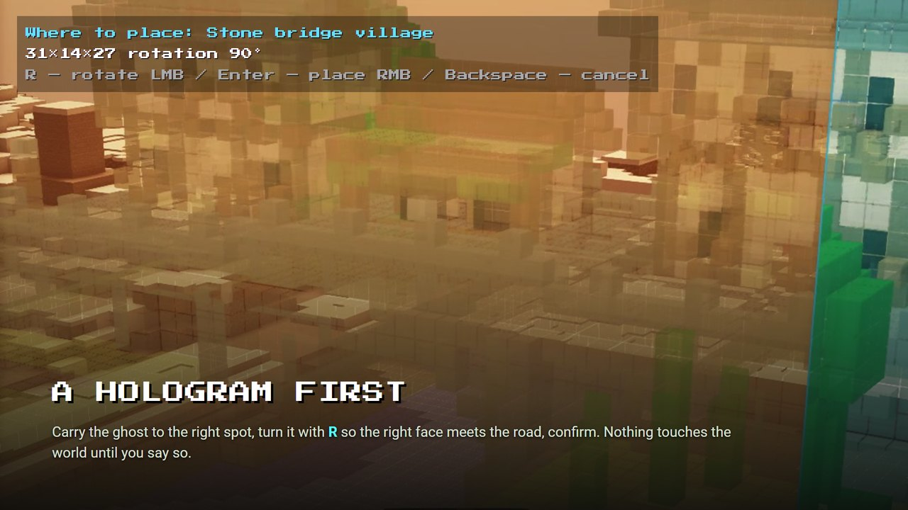
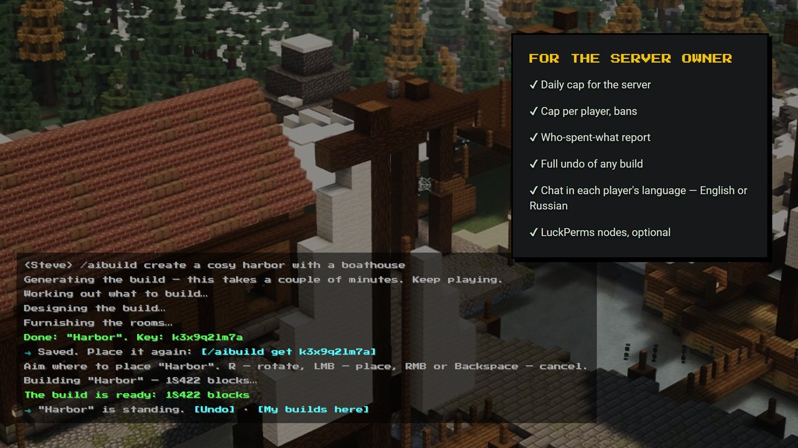

<h1 align="center">Farmstead AI Builder</h1>

<p align="center">
  <b>Русский</b> · <a href="README.en.md">English</a>
</p>

<p align="center">
  <b>Мод для Minecraft, который строит по текстовому описанию.</b><br>
  Игрок пишет <code>/aibuild create средневековая таверна с верандой</code> — через пару минут
  постройка вырастает у него на глазах, блок за блоком.
</p>

<p align="center">
  <i>A Minecraft mod that generates buildings from a text prompt: type what you want, aim the
  hologram, watch it built block by block. NeoForge 1.21.1.</i>
</p>

<p align="center">
  
  
  
  
</p>

<p align="center">
  
</p>

<p align="center">
  <a href="https://github.com/shtanko-michael/farmstead-aibuilder/releases/latest/download/farmstead-aibuilder-neoforge-1.21.1.jar"><b>⬇ Скачать последнюю версию</b></a>
  ·
  <a href="https://farmsteadminecraft.online/cabinet/ai-builder"><b>Получить токен</b></a>
  ·
  <a href="#команды">Команды</a>
  ·
  <a href="#права-и-luckperms">Права</a>
</p>

---

## Как это выглядит

| | |
|---|---|
|  |  |
| Замок вырастает из своей голограммы | Галеон в собственном доке |
|  |  |
| Таверна из бруса, ряд за рядом | Целая гавань по одному описанию |
|  |  |
| Не только дома: сад с сакурой | Мельница — вместе с крыльями |
|  |  |
| Голограмма: куда и какой стороной, поворот на R | Каждый шаг — в чате, команды кликабельны |

Ролики сняты на реальном сервере с шейдерами, ускорены в 4 раза.

---

## Что умеет мод

**Генерация построек по описанию.** Игрок описывает словами, что хочет — дом, башню, мост, ферму,
целую площадь — и получает готовую структуру. Не заранее заготовленные схематики: каждая постройка
собирается под конкретный запрос, поэтому «маленький рыбацкий домик на сваях» и «высокая каменная
башня с флагом» выходят разными зданиями, а не одним шаблоном с другой текстурой.

**Голограмма перед установкой.** В мир не пишется ни одного блока, пока игрок не согласится.
Постройка сначала показывается призраком под прицелом: её можно отнести подальше, повернуть на `R`
нужной стороной к дороге и только потом подтвердить. Отмена — один клик, и ничего не произошло.

**Стройка на глазах, а не «раз — и появилось».** Блоки ложатся рядами снизу вверх, за фронтом
укладки идёт светящаяся пыль, каждый севший блок вспыхивает, сверху бьёт луч. Это не косметика ради
косметики: игрок видит, что именно и куда встаёт, и успевает передумать. Сервер при этом не
проседает — укладка идёт с бюджетом в пару миллисекунд на тик, а не одним куском.

**Генерация в выделенную область.** `/aibuild area` — отметить углы прямо в мире, и постройка будет
сгенерирована **под этот объём**: не обрезана по нему, а спланирована так, чтобы в него попасть.
Удобно вписывать здание в готовую застройку.

**Полная отмена.** Мод помнит, что стояло под каждой постройкой, и `/aibuild undo` возвращает землю
в прежний вид — вместе с деревьями, склоном и чужой дорогой, по которой прошлись. Отменить можно и
не последнюю постройку, а любую из списка `/aibuild placed`.

**Своя библиотека у каждого игрока.** Постройки сохраняются: `/aibuild list` показывает свои,
`/aibuild get <ключ>` ставит ещё раз — в другом месте, другой стороной, сколько угодно раз, и уже
бесплатно.

**Работает с ванильным клиентом.** Игрок без мода тоже может пользоваться командой — постройка
просто ставится перед ним, без прицеливания. Но голограмму и анимацию рисует клиентская часть, так
что мод стоит раздать всем.

**Контроль расходов у администратора.** Генерация оплачивается токенами с вашего аккаунта, и вы
задаёте, кто и сколько может тратить: общий лимит сервера в сутки, лимит на игрока, персональный
лимит конкретному человеку, запрет отдельным игрокам. Всё это — на одной странице в кабинете, вместе
с отчётом «кто сколько потратил».

---

## Как это работает

1. **Игрок пишет команду.** `/aibuild create <описание>` — обычный текст, на русском или английском.
2. **Генерация идёт на нашем сервисе.** Ваш сервер отправляет описание на
   `ai.farmsteadminecraft.online` и получает готовый набор блоков. Модели, промпты и вычисления —
   на нашей стороне; вашему серверу не нужны ни видеокарта, ни ключи от нейросетей.
3. **Мод ставит постройку.** Голограмма, подтверждение, послойная укладка, запись для отмены.

Платит **владелец токена** — вы, со своего баланса AI-токенов на
[farmsteadminecraft.online](https://farmsteadminecraft.online). Одна постройка обычно стоит
**200–600 токенов**; лимиты и расход видны в кабинете.

---

## Поддерживаемые сборки

| Загрузчик | Версия игры | Файл релиза |
|---|---|---|
| NeoForge | 1.21.1 | `farmstead-aibuilder-neoforge-1.21.1.jar` |

Paper/Purpur, Fabric и Forge 1.20.1 — в планах.

Имя файла не содержит версию намеренно: обновление **перезаписывает** старый jar, а не кладёт рядом
второй с тем же mod id (FML в такой ситуации молча загрузит один из них). Версия — в названии релиза
и в манифесте jar. Постоянная ссылка на свежую сборку:
[releases/latest/download/farmstead-aibuilder-neoforge-1.21.1.jar](https://github.com/shtanko-michael/farmstead-aibuilder/releases/latest/download/farmstead-aibuilder-neoforge-1.21.1.jar).

## Требования

- Сервер **NeoForge 1.21.1**, Java 21.
- **Тот же jar у игроков** в `mods/` клиента: клиентская половина рисует голограмму-прицел
  (`R` — поворот, ЛКМ/Enter — поставить, ПКМ/Backspace — отменить) и всю анимацию стройки.
- Аккаунт на [farmsteadminecraft.online](https://farmsteadminecraft.online) с AI-токенами на балансе.
- Исходящий HTTPS с сервера на `ai.farmsteadminecraft.online`.
- **LuckPerms — необязателен.** Нужен, только если хотите раздавать команды по группам, а не
  уровнями прав из конфига.

Игрок **без** мода на сервер зайдёт (его не отвергают), но постройка просто появится перед ним — без
прицела и без анимации. Это аварийный режим, а не способ играть.

## Установка

1. Скачайте [последний релиз](https://github.com/shtanko-michael/farmstead-aibuilder/releases/latest)
   и положите jar в `mods/` сервера. Тот же файл раздайте игрокам.
2. Запустите сервер один раз — появится `config/farmstead_aibuilder.toml`.
3. В кабинете [farmsteadminecraft.online/cabinet/ai-builder](https://farmsteadminecraft.online/cabinet/ai-builder)
   нажмите «Создать токен». Значение показывается **один раз** — скопируйте сразу.
4. Впишите его в конфиг:

   ```toml
   [api]
   api_base_url = "https://ai.farmsteadminecraft.online"
   bearer_token = "fsm_..."
   ```

5. Перезапустите сервер. В логе появятся две строки:

   ```
   [hello] AI service OK: server='Основной сервер' mode=external apiVersion=1 …
   [regionguard] API not available (…) — claim checks are skipped
   ```

   Первая — токен принят. Если вместо неё `[hello] the AI service rejected this server's token`,
   токен вписан неверно или отозван. Вторая — про защиту территорий, см. [ниже](#территория).

Токен — это ключ к вашему кошельку. Не публикуйте конфиг. Утёк — отзовите в кабинете и создайте новый.

## Команды

Токены тратит только `create` (и `area build`). Всё остальное бесплатно.

| Команда | Что делает | Токены | Нода |
|---|---|---|---|
| `/aibuild create <описание>` | Сгенерировать постройку и поставить через голограмму | **да** | `aibuilder.command.create` |
| `/aibuild area` | Режим выделения: ЛКМ — угол 1, ПКМ — угол 2, Backspace — выход | — | `aibuilder.command.area` |
| `/aibuild area build <описание>` | Сгенерировать **в выделенную область** | **да** | `aibuilder.command.area` |
| `/aibuild area pos1` / `pos2` / `clear` | Углы с позиции игрока (для клиента без мода) и сброс | — | `aibuilder.command.area` |
| `/aibuild list [страница]` | Свои постройки списком, строка кликабельна | — | `aibuilder.command.list` |
| `/aibuild get <ключ>` | Поставить свою постройку ещё раз | — | `aibuilder.command.get` |
| `/aibuild placed [страница]` | Что из своего стоит в этом мире | — | `aibuilder.command.placed` |
| `/aibuild undo` | Снять последнюю постройку и вернуть, что было под ней | — | `aibuilder.command.undo` |
| `/aibuild remove <n>` | То же для любой строки `placed` | — | `aibuilder.command.undo` |
| `/aibuild balance` | Сколько токенов осталось игроку на сегодня | — | `aibuilder.command.balance` |
| `/aibuild topup` | Объясняет, что генерации оплачивает администратор | — | `aibuilder.command.topup` |
| `/aibuild`, `/aibuild help` | Команды, доступные этому игроку | — | — |
| `/aibuild about` | Версия мода и регистрация сервера | — | — |
| `/aibuild status` | Расход за сегодня, действующий лимит, кулдаун и состояние кошелька (операторы, работает из консоли) | — | `aibuilder.command.status` |

Постройки игроков вашего сервера видны только на нём: у них нет доступа к лаунчеру и маркету
Farmstead, и ваш собственный кабинет их не показывает — только расход.

## Права и LuckPerms

У каждой подкоманды **две двери, и достаточно любой**:

1. **Vanilla permission level** из `config/farmstead_aibuilder.toml`, секция `[permissions]`:
   `0` — все, `2` — операторы (уровень `/give`, `/setblock`), `4` — владелец/консоль.
2. **Нода** `aibuilder.command.*`, выданная менеджером прав.

По умолчанию все уровни — `0`, команды открыты всем: настоящий ограничитель — ваши дневные лимиты в
кабинете, а не права.

> **Порядок важен.** Нода при `level = 0` ничего не меняет: уровень 0 проходят все, и до проверки
> ноды дело не доходит. Сначала поднимите уровень, потом выдавайте ноду.

Мод объявляет свои ноды в NeoForge Permission API, поэтому **LuckPerms видит их сам** — ставить
ничего дополнительно не нужно.

Типовой сценарий «генерация только донатерам, остальное всем»:

```toml
# config/farmstead_aibuilder.toml
[permissions]
create_level = 4   # закрыли create и area от всех, кроме консоли
area_level   = 4
```

```
/lp creategroup builder
/lp group builder permission set aibuilder.command.create true
/lp group builder permission set aibuilder.command.area true
/lp user Steve parent add builder
```

Разово одному игроку: `/lp user Steve permission set aibuilder.command.create true`.
Забрать обратно: `/lp group builder permission unset aibuilder.command.create` — тогда снова решает
уровень.

Полный список нод:

```
aibuilder.command.create    aibuilder.command.area     aibuilder.command.get
aibuilder.command.list      aibuilder.command.placed   aibuilder.command.undo
aibuilder.command.balance   aibuilder.command.topup    aibuilder.command.status
```

`undo` и `remove` делят одну ноду (`aibuilder.command.undo`): это одна власть над одними записями.

**Без менеджера прав** ноды никто не выдаёт, и весь гейт — уровни из конфига. Операторы проходят
всё: `/op` даёт уровень 4, а он перекрывает любой уровень ниже.

## Лимиты и расход

Всё в кабинете, на той же странице, где создан токен:

- **Общий лимит в день** — сколько токенов сервер может потратить за сутки (UTC).
- **Лимит на игрока в день** — по умолчанию для всех; в таблице игроков можно задать персональный
  или **запретить** игроку генерацию.
- **Отчёт** — кто сколько потратил за 7 / 30 дней, по игрокам и по дням.

Лимиты считаются на стороне сервиса, а не в моде: действуют сразу, перезапуск не нужен, обновление
мода их не сбрасывает.

## Территория

Мод умеет спрашивать **RegionGuard** и **Farmstead Claims** (если стоят оба — Farmstead Claims). Что он делает, видно в логе при старте:

| Строка в логе | Что значит |
|---|---|
| `[regionguard] API available (ClaimsApi / RegionGuardApi) — claims are enforced for non-operators` | Приваты проверяются: постройка целиком должна попадать в регион игрока |
| `[regionguard] API not available — claim checks are skipped` | Плагина нет, мод о ваших приватах не знает и территорию **не проверяет** |

Без мода приватов игрок поставит постройку везде, где ему разрешена команда. Варианты: поднять
`create_level`/`area_level` и выдавать ноду доверенным, ограничить дневным лимитом — или поставить
RegionGuard либо Farmstead Claims.

Если мод приватов стоит, но его вызов упал, мод **откажет** в установке и напишет
`[regionguard] claim check failed` — сломавшаяся защита не должна читаться как «разрешено».

## Что уходит на сервис

С каждым запросом сервис получает: **описание постройки**, **ID игрока** (UUID) и **его ник** — чтобы
показать вам расход по игрокам. Ничего другого с сервера не читается. Снимок «что стояло под
постройкой» хранится как непрозрачные байты и нужен только для `/aibuild undo`.

## Если что-то не так

| В логе или в чате | Что это значит |
|---|---|
| `[hello] … rejected this server's token` | Токен неверный или отозван — проверьте `bearer_token` |
| `Ваш лимит на сегодня исчерпан` | Дневной лимит игрока — поднимите в кабинете или подождите до полуночи UTC |
| `Дневной лимит сервера исчерпан` | Общий лимит сервера — то же |
| `Администратор сервера закрыл вам генерацию` | Игрок в списке запрещённых |
| `Сервис занят` | Слишком много одновременных генераций — попробуйте через минуту |
| `Недостаточно токенов` | На вашем AI-кошельке меньше минимума — пополните в кабинете |
| `[regionguard] claim check failed` | Мод приватов стоит, но его вызов упал; установка отклоняется, пока это не починено |
| Команда с русским текстом «не проходит» | Какой-то мод фильтрует символы в командах (у NeoEssentials — `security.allowUnsafeCommands`) |

## Язык

Мод говорит по-русски и по-английски. По умолчанию каждый игрок читает чат на языке своей игры (русский — для русского, украинского, белорусского и казахского клиента, английский — для остальных); подсказки голограммы на экране всегда следуют языку клиента. Закрепить один язык для всего сервера:

```toml
# config/farmstead_aibuilder.toml
[language]
language = "ru_ru"   # auto | en_us | ru_ru
```

Ошибки и предложения — в [Issues](https://github.com/shtanko-michael/farmstead-aibuilder/issues).

---

## Лицензия

Устанавливать на свои серверы и **раздавать игрокам своего сервера** — можно, в том числе на платных
серверах. Публиковать на файлообменниках и в каталогах модов, декомпилировать и изменять — нельзя.
Полный текст: [LICENSE.md](LICENSE.md).

История версий — [CHANGELOG.md](CHANGELOG.md). Нашли способ обойти токен, лимиты или права —
[SECURITY.md](SECURITY.md), не открывайте публичный issue.
